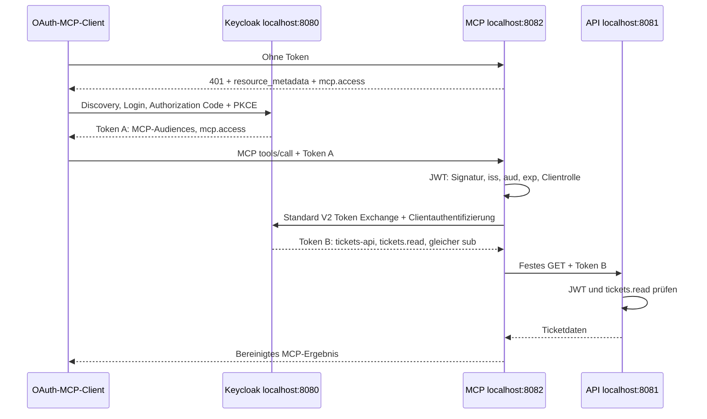

# Lokale MCP-Demo: API-seitig erzwungenes Least Privilege

Diese Demo zeigt denselben Benutzer auf zwei Zugriffswegen: Sein direktes API-Token darf Tickets lesen und schreiben. Über MCP erhält er durch Keycloak Standard Token Exchange ein separates API-Token mit ausschließlich `tickets.read`. Ein echter Schreibversuch mit genau diesem Exchange-Token liefert **403**, ohne die Daten zu ändern.

**Aktueller Scope: ausschließlich localhost.** API und MCP laufen als separate Java-Prozesse; Keycloak und PostgreSQL lokal in Docker. Keine öffentlichen Domains, DNS-Änderungen oder Deployments. Alle Benutzer und Tickets sind synthetisch.

## Starten

Voraussetzungen: JDK 21, Python 3.10+, Docker mit Compose und laufendem Docker-Dienst.

Für `./demo agent` ist Python **3.11+** erforderlich. Der Launcher prüft die Version vor dem Start und sucht bei einem zu alten Conda-`python3` nach einem geeigneten vorhandenen Interpreter im `PATH` sowie in üblichen macOS-Installationsverzeichnissen. Er verändert weder Conda noch den Benutzer-`PATH`. Mit `DEMO_PYTHON=/absoluter/pfad/python3 ./demo …` lässt sich ein geeigneter Interpreter ausdrücklich wählen. Fehlt er, erscheint eine kurze Mindestversionsmeldung statt eines Import-Tracebacks.

Maven wird durch den Wrapper heruntergeladen und per SHA-256 geprüft. Auf macOS wählt `./demo` automatisch ein installiertes JDK 21, wenn `JAVA_HOME` nicht gesetzt ist. Auf anderen Systemen ein JDK 21 im `PATH` verwenden oder `JAVA_HOME` setzen.

```sh
./demo setup
./demo build
./demo up
./demo status
```

Der erste Start benötigt Zeit für Downloads und die Keycloak-Datenbankinitialisierung. Das Startskript wartet auf die Dienste. Bei belegten API-/MCP-Ports oder fehlenden JARs startet es keine Dienste. Fehler beim Anwendungsstart beenden die neu gestarteten Java-Prozesse; die lokale Infrastruktur bleibt zur Diagnose verfügbar.

| Dienst | Lokale Adresse | Zugriff |
|---|---|---|
| Keycloak | <http://localhost:8080> | Realm `mcp-demo`; Admin `local-admin` |
| REST-API | <http://localhost:8081/tickets> | Bearer-Token für `tickets-api` |
| API-Health | <http://localhost:8081/health> | Öffentlich auf Loopback |
| OpenAPI | <http://localhost:8081/openapi.yaml> | Statische Spezifikation |
| MCP | <http://localhost:8082/mcp> | Streamable HTTP, Bearer-Token für diese Ressourcen-URL |
| Resource Metadata | <http://localhost:8082/.well-known/oauth-protected-resource/mcp> | OAuth-Einstieg |
| OAuth-Callback | `http://127.0.0.1:8765/callback` | Nur während des Testclient-Logins |
| PostgreSQL | Docker-intern `postgres:5432` | Kein Host-Port veröffentlicht |

Host-Bindings für API/MCP: `127.0.0.1`. Docker veröffentlicht Keycloak auf `127.0.0.1:8080`. Keycloak verwendet den festen Issuer `http://localhost:8080/realms/mcp-demo`; beide Java-Anwendungen und der Browser erreichen genau diesen Issuer. Es gibt keine abweichende Container-Issuer-Adresse und keine abgeschaltete Issuer-/Audience-Prüfung.

## Vorführen

### 1. API direkt lesen und schreiben

Der direkte Client verwendet `api-demo-client` und meldet den Benutzer per Authorization Code + S256-PKCE bei Keycloak an. Er ruft die API direkt auf; MCP ist an diesem Weg nicht beteiligt. Tokens bleiben im jeweiligen Clientprozess und werden nicht ausgegeben.

```sh
./demo api list
./demo api get 1
./demo api create --title "Demo-Ticket" --description "Synthetisches Beispiel" --status OPEN
```

`list` entspricht `GET /tickets` (HTTP 200), `get 1` entspricht `GET /tickets/1`, `create` sendet `POST /tickets` (HTTP 201). Die Antwort enthält die neu erzeugte `id`. Diese ID für die folgenden Befehle einsetzen, hier beispielhaft `4`:

```sh
./demo api patch 4 --status IN_PROGRESS
./demo api get 4
./demo api delete 4
./demo api list --status OPEN --offset 0 --limit 20
```

`patch` liefert HTTP 200, `delete` HTTP 204. Jeder Aufruf ist ein eigener Prozess mit einem frischen Login; es gibt keinen Token-Store. Für die wiederholbare lokale Demo kann das vorhandene Keycloak-Formular automatisch ausgefüllt werden. `--headless-login` steht beim API-Client **vor** dem Unterbefehl:

```sh
./demo api --headless-login list
./demo api --headless-login create --title "Demo-Ticket" --description "Synthetisches Beispiel"
```

Auch dabei wird der echte PKCE-Codefluss benutzt. Für den manuellen Browser-Login: Benutzer `demo`, Passwort aus dem lokalen Feld `demo_password` in `.local/secrets.json`. Die Datei lokal öffnen, beispielsweise auf macOS mit `open -a TextEdit .local/secrets.json`; keine Werte in den Chat kopieren. Ein einfacher Browser-/curl-Aufruf von `/tickets` ohne Anmeldung liefert erwartungsgemäß 401. Der Client übernimmt die Bearer-Header intern.

Befehlsoptionen: `./demo api --help`, `./demo api create --help`. CLI-Implementierung: [scripts/api_client.py](scripts/api_client.py).

### 2. Echter Browser-Login und MCP-Aufruf

```sh
./demo client
```

Der vorregistrierte Client `mcp-demo-client` öffnet Keycloak im Standardbrowser. Mit dem synthetischen Benutzer `demo` anmelden. Das lokal generierte Passwort steht im Feld `demo_password` in `.local/secrets.json`; diese Datei lokal öffnen. Der Client nimmt den OAuth-Callback entgegen, prüft `state` und `iss`, tauscht den Code mit dem PKCE-Verifier und ruft anschließend MCP `initialize`, `notifications/initialized`, `tools/list` und `list_tickets` auf. Ausgegeben werden nur Schemas und Ticketdaten. Access-Tokens bleiben im Prozessspeicher.

Ein einzelnes Ticket und gefilterte Listen lassen sich direkt auswählen:

```sh
./demo client --ticket 1
./demo client --status OPEN --offset 0 --limit 10
```

`--ticket` ruft nach Initialisierung und Tool-Auflistung `get_ticket` auf; ohne `--ticket` wird `list_tickets` aufgerufen. Der enthaltene Client spricht das echte MCP-Protokoll, verwendet aber selbst kein LLM.

Für eine wiederholbare Vorführung ohne manuelles Ausfüllen:

```sh
./demo client --headless-login
./demo client --headless-login --ticket 1
```

Dieser Modus durchläuft denselben Authorization-Code-/PKCE-Fluss einschließlich Keycloak-Loginformular und tatsächlichem Loopback-Callback. Er verwendet **keinen Password Grant** und keine eingefügten Bearer-Tokens. Der reine HTTP-Formulartreiber behandelt Secure-Cookies ausschließlich für `http://localhost:8080` wie ein Browser auf localhost. Der interaktive Modus verwendet den Browser selbst.

#### Eigenständiger Codex-Agent

Die lokale Codex-CLI kann den MCP-Server direkt über **Streamable HTTP** verwenden. Voraussetzungen: Codex-Modellzugang, Python **3.11+**, laufende Demo und freier Callback-Port **8766**.

```sh
./demo agent setup
./demo agent list
./demo agent login
./demo agent run
# Lokale MCP-Zugangsdaten später entfernen:
./demo agent logout
```

Der echte LLM-Agent ruft `list_tickets` und `get_ticket` ab. Codex übernimmt OAuth-Discovery und Browser-PKCE über den eigenen Public Client `codex-demo-client`; seine Zugangsdaten liegen im Betriebssystem-Schlüsselbund. Die öffentliche Konfiguration in [integrations/codex.toml](integrations/codex.toml) wirkt nur über den Launcher. Globale Codex-Konfiguration wird nicht geändert. API, MCP, Keycloak und PostgreSQL bleiben lokal; die Modellinferenz verwendet den bestehenden OpenAI-Zugang und synthetische Tickets.

[Einrichtung, Rechte, Offline-Refresh, Abmeldung und Fehlerbehebung](integrations/README.md). Der eigene Python-Client bleibt zusätzlich verfügbar. Andere Agenten oder ein MCP Inspector sind nicht mitgeprüft; Cloud-Agenten erreichen dieses localhost ohne zusätzliche Netzwerkarchitektur nicht.

### 3. Vollständiger Rechtebeweis

```sh
./demo test
```

Der Live-Test meldet jeden bestandenen Check. Er:

1. meldet denselben Benutzer getrennt für API und MCP mit Authorization Code + S256-PKCE an;
2. erzeugt und ändert ein Ticket über die API und liest es über beide MCP-Tools zurück;
3. fordert im Testprozess mit dem echten vertraulichen MCP-Client ein Exchange-Token B an;
4. verwendet **genau dieses Token B** zum Lesen, Anlegen, Ändern, Löschen und Reset: Lesen erfolgreich, alle Schreibversuche 403; nach jedem Versuch identischer Datenbestand;
5. prüft Audience-Verwechslungen, fehlende/fehlerhafte Signaturen und Tokens, fehlende Rollen, tatsächlichen Ablauf sowie vier Schreib-Scope-Anforderungen beim Exchange;
6. prüft einen zweiten Benutzer und bereinigte Tool-Ergebnisse/Anwendungslogs;
7. löscht das direkt erzeugte Ticket und stellt die drei Seed-Tickets wieder her.

**Welche Tokens werden unterschieden?** Alle Tokens stellt Keycloak aus; die API erzeugt keine Tokens. Token A ist für Client → MCP bestimmt, Token B für MCP → API. Das direkte API-Token gehört zum separaten direkten Benutzerlogin und darf beim Benutzer `demo` zusätzlich schreiben. Praktisch belegen dies nicht nur unterschiedliche Strings oder Claims, sondern die Live-Ergebnisse: A an API → 401, API-Tokens an MCP → 401, B liest → 200, dieselbe im Test ausgestellte B-Instanz schreibt → 403 bei unveränderten Daten. Der Test prüft außerdem denselben Benutzer-`sub` und die begrenzten Rollen. Rohe JWTs oder Secrets werden nicht angezeigt.

Die zusätzlichen Schreibversuche existieren ausschließlich im Testprozess. Der reguläre MCP-Server besitzt keine Schreibtools, kein Debug-Token-Tool und keinen generischen HTTP-Proxy. Das im Test separat angeforderte Token B entsteht über denselben Keycloak-Requester und dieselbe Policy wie die Backend-Tokens des MCP-Servers; kein Backend-Token wird aus dem Server exportiert.

Das Ergebnis steht ohne Tokens/Secrets in `.local/verification.json`. Der Zeitpunkt gehört zum Ergebnis; ein neuer Lauf entfernt den alten Erfolgsbericht vorab. Der Live-Test setzt laufende Dienste voraus und ist vom Maven-Test getrennt.

### 4. Reset, Stop und erneuter Start

```sh
./demo reset                    # API-Login im Browser, benötigt tickets.write
./demo reset --headless-login   # derselbe Flow mit automatischem Formular
./demo stop                     # nur API/MCP beenden
./demo down                     # zusätzlich Keycloak/PostgreSQL stoppen
./demo up                       # gebaute JARs erneut starten
```

Der PostgreSQL-Volume bleibt bei `down` bestehen. Tickets liegen ausschließlich im API-Arbeitsspeicher und werden auch bei API-Neustart zurückgesetzt. `.local` und der Volume müssen zusammen erhalten bleiben: neue Secrets passen nicht zu einer bereits importierten Realm-Konfiguration.

## Architektur und Rechte



| Weg / Client | Audience | Explizite Clientrollen |
|---|---|---|
| Direkt: `api-demo-client` | `tickets-api` | Benutzerabhängig `tickets.read` und `tickets.write` |
| Token A: `mcp-demo-client` | `mcp-server` und `http://localhost:8082/mcp` | `resource_access.mcp-server.roles`: `mcp.access` |
| Token B: vertraulicher `mcp-server` | exakt `tickets-api` | `resource_access.tickets-api.roles`: ausschließlich `tickets.read` |

`mcp-server` ist in Token A zusätzlich als Audience erforderlich, weil Keycloak den Exchange-Requester im Subject-Token voraussetzt. Die MCP-Ressourcen-URL ist eine weitere, separat gemappte Audience. Der Testclient sendet den OAuth-Parameter `resource` bei Authorization und Token Request; die feste Ressourcenbindung wird durch die vorregistrierten Client-Mapper und die JWT-Audience-Prüfung umgesetzt. Beliebige Ressourcen werden dadurch nicht dynamisch freigeschaltet.

Die API akzeptiert ausschließlich ihre eigenen Clientrollen; Realm-Rollen und Rollen anderer Clients verleihen keine API-Rechte. Ein Text wie `scope=tickets.write` allein erteilt kein Schreibrecht. Keycloak verknüpft die angeforderten Client-Scopes mit den tatsächlich zugewiesenen Benutzerrollen.

Für den Exchange-Requester gilt `fullScopeAllowed=false`, Default-Scope `tickets.read`, **keine optionalen Scopes**, keine Composite-Rollen, kein Client-Credentials-Grant und keine reguläre Browser-Anmeldung. Standard Token Exchange V2 ist explizit eingeschaltet; die Legacy-Preview wird nicht aktiviert. Audience-Filterung allein ist keine Rechtebegrenzung: Entscheidend sind die Role Scope Mappings. Der MCP-Server prüft Token B zusätzlich auf denselben Benutzer, exakte API-Audience und genau die Leseberechtigung.

Identität und feste Audiences werden unabhängig von rollenabhängigen Scopes gemappt. Deshalb bekommen auch Benutzer ohne Berechtigung ein korrekt adressiertes Token, das am geschützten Endpunkt mit **403** scheitert; solche Tests werden nicht versehentlich bereits durch eine falsche Audience mit 401 erfüllt.

### API und Tools

| Operation | Berechtigung |
|---|---|
| `GET /tickets`, `GET /tickets/{id}` | `tickets.read` |
| `POST /tickets`, `PATCH /tickets/{id}`, `DELETE /tickets/{id}` | `tickets.write` |
| `POST /demo/reset` | `tickets.write` |
| MCP `list_tickets`, `get_ticket` | `mcp.access`; Backend separat mit `tickets.read` |

Tickets: `id`, `title`, `description`, `status` (`OPEN`, `IN_PROGRESS`, `CLOSED`). `list_tickets`: optional `status`, `offset >= 0`, `limit` von 1 bis 100. `get_ticket`: positive ganzzahlige `id`. Schemas und tatsächliche Argumentprüfung schließen fremde URLs, Methoden und Header aus. Tool-Ergebnisse behandeln Ticketinhalt als Daten und enthalten keine Transportkontexte oder Zugangsdaten.

Streamable HTTP läuft zustandslos; jeder geschützte HTTP-Aufruf wird authentifiziert. Eine MCP-Session ersetzt keine OAuth-Prüfung. Token A wird niemals an die API durchgereicht. Die eigenen Python-Clients und der MCP-Server speichern Access-/Refresh-Tokens nicht dauerhaft und führen keinen Token-Cache. Die optionale Codex-Integration nutzt dagegen den Betriebssystem-Schlüsselbund und Offline-Refresh; siehe [Integration](integrations/README.md). Keycloak verwaltet seine regulären Benutzer-/Login-Sessions lokal in PostgreSQL.

## Versionen, Struktur und Prüfungen

| Komponente | Festgelegte Version |
|---|---|
| Java-Sprach-/Buildziel | 21 LTS |
| Spring Boot | 3.5.16 |
| Offizielles MCP Java SDK | 0.18.5, Spring-WebMVC-Transport, Jackson 2 |
| Maven / Wrapper | 3.9.16 / 3.3.4, Distribution mit SHA-256 |
| Keycloak | 26.8.1, Image-Digest in Compose |
| PostgreSQL | 17.11-alpine, Image-Digest in Compose |
| Im Test ausgehandeltes MCP-Protokoll | 2025-06-18 |

Der SDK-0.18-Zweig passt zum Spring-6-/Boot-3-Stack. Die separate Spring-AI-Schicht ist für diese zwei expliziten Tools nicht erforderlich; der Server verwendet direkt das offizielle Java SDK. Die Basisdemo mit Python-Clients benötigt kein LLM-Konto und keinen Modell-API-Key. Der optionale eigenständige Codex-Agent benötigt einen eingerichteten Modellzugang.

- `security-common/`: JWT-Validatoren und explizite Clientrollen-Zuordnung.
- `ticket-api/`: REST-API, validierte Eingaben, synchronisierter In-Memory-Speicher, OpenAPI.
- `mcp-server/`: geschützter MCP-Transport, Metadaten, zwei Tools, Token Exchange, feste Backend-Aufrufe.
- `scripts/setup.py`: nachvollziehbare Realm-Konfiguration; erzeugt nur lokale Secrets/Importdateien.
- `scripts/client.py`: kleiner realer OAuth-/MCP-Client mit Browser- und HTTP-Formularmodus.
- `scripts/api_client.py`: direkter API-CRUD-Client mit demselben sicheren PKCE-Loginmechanismus.
- `scripts/e2e.py`: Live-Abnahmematrix; alle Tokens bleiben im Prozess.
- `scripts/demo.py`, `demo`: lokaler Start-/Stop-Helfer.

```sh
./demo build
# Hier ausdrücklich Python 3.11+ verwenden, auch bei aktivem Conda:
python3 -m unittest discover -s scripts -p 'test_*.py' -v
./demo test
```

Die Java-Tests prüfen Claim-Validatoren, Clientrollen-Zuordnung, tatsächliche API-Endpunktregeln/Datenänderungen und MCP-Sicherheitsregeln. MockMvc-Tests ersetzen den JWT-Decoder; sie sind **kein Signaturnachweis**. Signaturen, echte Keycloak-Ausstellung und das gesamte HTTP-/MCP-Verhalten prüft der separate Live-Lauf. Details und geprüfter Stand: [docs/VERIFICATION.md](docs/VERIFICATION.md).

## Lokale Konfiguration und Troubleshooting

- `./demo setup` legt `.local/` mit Modus 0700 und `secrets.json`, `realm.json`, `docker.env` mit 0600 an. Vorhandene Konfiguration wird erhalten. Dateien sind Git-ignoriert; keine Access-Tokens hineinkopieren.
- `mcp_client_secret` gelangt über die Prozessumgebung an MCP, nicht als Kommandozeilenargument. Compose erhält seine Secrets über die lokale Env-Datei. Tokens, Secrets und Backend-Fehlertexte werden weder in Tool-Ergebnisse noch in reguläre Logs geschrieben.
- Kein Docker-Daemon: Docker Desktop bzw. den lokalen Docker-Dienst starten, dann `./demo up`.
- Java-Version falsch: `JAVA_HOME` auf ein JDK 21 setzen. Für Neubauten zuerst `./demo stop`, dann `./demo build` und `./demo up`.
- Startfehler: `.local/ticket-api.log`, `.local/mcp-server.log` sowie `docker compose --env-file .local/docker.env logs --tail 100 keycloak` lokal prüfen. Keine Debug-HTTP-/Security-Trace-Logs aktivieren.
- Belegter Port: 8080 (Keycloak), 8081 (API), 8082 (MCP), 8765 (Login-Callback) freihalten. Der Callback erlaubt jeweils nur einen Login gleichzeitig. `./demo up` prüft beide Anwendungs-JARs/Ports vor dem Start und überschreibt keine vorhandenen Prozesse.
- `401`: fehlendes, ungültiges oder abgelaufenes Token bzw. falsche Audience/Issuer. Token A an der API ist absichtlich 401. `403`: korrekt authentifiziert, aber erforderliche Rolle fehlt.
- Keycloak importiert einen vorhandenen Realm beim Neustart **nicht erneut**. Änderungen an `setup.py` allein ändern keinen bestehenden Realm. Für eine frische Importprüfung kann nach `./demo down` ein eigener temporärer Compose-Projektname verwendet werden: `COMPOSE_PROJECT_NAME=mcp-demo-repro ./demo up`. Die Volumes bleiben dabei getrennt. Danach mit demselben Projektnamen `./demo down` ausführen und regulär `./demo up` starten. Keine Volumes mit fremden Daten löschen.
- Keycloak läuft bewusst in `start-dev` und HTTP auf Loopback. Die Auslieferung über eine öffentliche Domain, TLS-Ingress, Hosting und produktiver Betrieb sind spätere Entscheidungen.

## Quellen

- [Keycloak Standard Token Exchange und Grenzen von audience/scope](https://www.keycloak.org/securing-apps/token-exchange)
- [Keycloak Role Scope Mappings](https://www.keycloak.org/docs/latest/server_admin/index.html#_role_scope_mappings)
- [Keycloak Protocol Mapper: Subject und Audience](https://www.keycloak.org/admin-api/protocol-mappers)
- [Offizielles MCP Java SDK](https://github.com/modelcontextprotocol/java-sdk)
- [MCP-Autorisierung](https://modelcontextprotocol.io/specification/latest/basic/authorization)
- [Keycloak mit PostgreSQL](https://www.keycloak.org/server/db)

Repository: [timsauer111/demo-mcp](https://github.com/timsauer111/demo-mcp), lokale Implementierung im Branch `codex/local-oauth-demo`. Quellcode wird auf ausdrücklichen Benutzerauftrag in dieses private GitHub-Repository gepusht. Laufzeit und Daten bleiben ausschließlich lokal; kein Deployment oder DNS-Eingriff.
