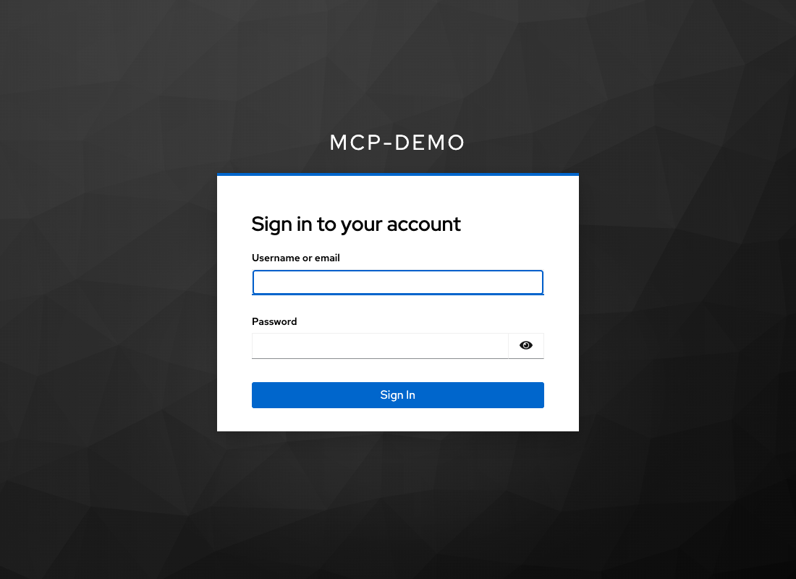
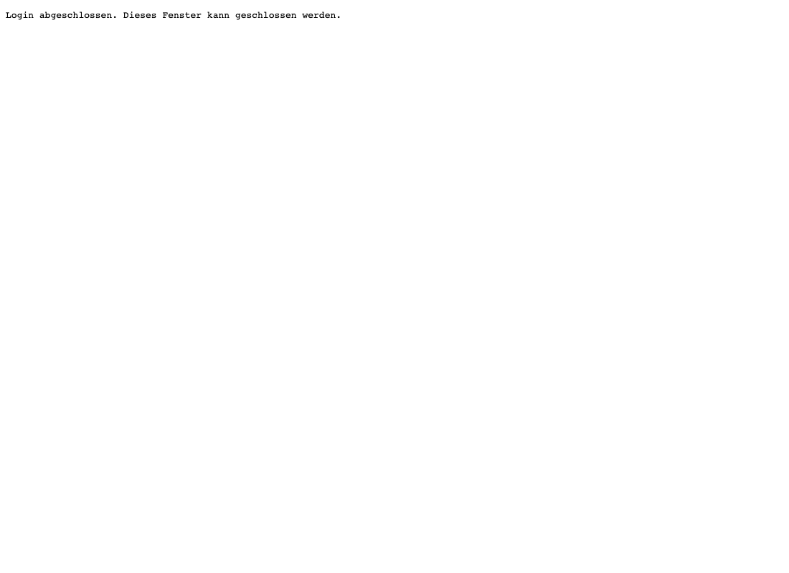

# Verifikation der lokalen Demo

Geprüft am **23.10.2026**, lokal auf diesem Mac mit JDK 21.0.8, Docker und den im Repository festgelegten Versionen. Kein Deployment und keine DNS-Änderung. Der Quellcode-Push ist anschließend ausdrücklich vom Benutzer beauftragt worden.

| Prüfebene | Tatsächlich ausgeführt | Ergebnis |
|---|---|---|
| Maven-Build | `./demo build`, alle drei Module, JAR-Paketierung | Erfolgreich |
| Java-Unit-/MockMvc-Tests | 9 gemeinsame JWT-/Rollenprüfungen, 5 API-Prüfungen, 6 MCP-Prüfungen | **20/20 bestanden** |
| Python-CLI-/Supervisor-Tests | `python3 -m unittest discover -s scripts -p 'test_*.py' -v` | **19/19 bestanden** |
| Lokale Dienste | Keycloak 26.8.1, PostgreSQL 17.11, separate API/MCP-Java-Prozesse | Tatsächlich gestartet, Health/HTTP geprüft |
| Vollständiger Live-Lauf | `./demo test` mit echtem Keycloak Authorization Code + S256-PKCE, HTTP-Formular und Loopback-Callback | **59/59 bestanden** |
| Erststart/Reproduzierbarkeit | Eigenes Compose-Projekt `mcp-demo-repro` mit frischem PostgreSQL-Volume; keine Admin-Nachkonfiguration nach Import | Dieselben **59/59 bestanden** |
| Persistenter Standardstart | Temporäres Projekt beendet, Standardprojekt mit vorhandenem Volume erneut gestartet | Dieselben **59/59 erneut bestanden** |
| Echter Browser | Headless Chromium 156 mit lokal vorhandenem Playwright 1.62.1; tatsächliches Keycloak-Formular statt HTTP-Formulartreiber | Login → Callback → PKCE-Code-Einlösung → MCP-Initialisierung → Tool-Liste → Ticketabruf bestanden |
| Direkter API-/MCP-CLI-Nutzungsweg | API list/get/create/patch/delete mit echtem PKCE-Login; MCP --ticket und Listenfilter gegen denselben neu erzeugten Datensatz | Erfolgreich; anschließend drei Seed-Tickets erhalten |
| OpenAPI | YAML geparst, Antwortschema gegen die drei tatsächlich gelieferten API-Tickets geprüft | Erfolgreich |
| Obsidian | Neue Notiz über guarded CLI/App-API im richtigen Google-Drive-Vault angelegt; Inhalt/YAML und native Reading View geprüft | Richtige aktive Datei, Preview-Modus, Mermaid-SVG gerendert, keine erkannten Mermaid-Fehler; native Ansicht per Screenshot geprüft |
| Unabhängige Reviews | code-reviewer, security-reviewer, german-eu-legal-reviewer | Befunde behoben; keine offenen bestätigten Sicherheitsbefunde im lokalen Scope |

Der bereinigte maschinenlesbare letzte Live-Lauf steht in [verification.json](verification.json). Er enthält ausschließlich Zeitpunkt, Checknamen und Ergebnisse. Die lokale Ausführung legt denselben Bericht unter `.local/verification.json` ab. Die temporären Testcontainer und das ausschließlich für die Importprüfung erzeugte Volume wurden anschließend entfernt; das persistente Standard-Volume blieb erhalten.

## Entscheidender Rechtebeweis

- Derselbe synthetische Benutzer erhielt über zwei echte PKCE-Anmeldungen das direkte API-Token und Token A für MCP.
- Mit dem direkten API-Token waren GET, POST **201**, PATCH **200** und DELETE **204** erfolgreich. Datenänderung und tatsächliches Löschen wurden nachgelesen.
- Im Testprozess wurde **ein echtes Standard-V2-Exchange-Token B** über den vertraulichen Requester `mcp-server` angefordert. Genau diese Tokeninstanz wurde für erfolgreiches GET und für POST/PATCH/DELETE/Reset verwendet. Alle vier Schreibversuche lieferten **403**; nach jedem Versuch war der vollständige Demo-Datenbestand unverändert.
- Über beide MCP-Tools wurde das zuvor direkt erzeugte und geänderte API-Ticket zurückgelesen. Der MCP-Pfad liefert damit tatsächliche Backend-Daten.
- Token A an API sowie direktes und ausgetauschtes API-Token an MCP lieferten **401**. Fehlende/fehlerhafte Tokens und eine manipulierte Signatur wurden ebenfalls mit 401 abgewiesen.
- Echte kurzlebige Keycloak-Tokens wurden nach Ablauf abgewiesen. Das API-Token hatte dabei die richtige Audience und durfte unmittelbar vor Ablauf noch erfolgreich lesen.
- Ein Benutzer mit korrekt adressiertem Token, aber fehlender Rolle erhielt **403**. Benutzeridentität blieb beim Exchange erhalten und für zwei Benutzer getrennt.
- Alle vier Exchange-Anforderungen `tickets.write`, `tickets.read tickets.write`, `offline_access tickets.write` und `roles tickets.write` wurden von Keycloak abgewiesen.
- Die während des Testprozesses ausgestellten Tokens und die lokal erzeugten Geheimnisse wurden gegen MCP-Ausgaben und Anwendungslogs geprüft: keine Treffer. Der Test hat sie weder in Bericht noch Modellkontext ausgegeben.

Das im Test angeforderte Token B wird nicht aus dem laufenden MCP-Server exportiert. Test und Server verwenden denselben echten Keycloak-Requester und dieselbe begrenzte Policy. Der Server hat keinen Token-Ausgabeendpunkt und keine Schreibtools.

## Browserbeleg

Die Screenshots enthalten keine Passwörter, Tokens oder Callback-URLs:

Der Browsertest nutzte den enthaltenen Python-OAuth-/MCP-Client mit einem temporären Playwright-Browseröffner. Playwright ist keine Laufzeitabhängigkeit der Demo und nicht für `./demo client` oder `./demo test` erforderlich. Für die normale Vorführung öffnet `./demo client` den eigenen Standardbrowser.

## Beweisgrenzen

MockMvc verwendet für Endpunktregeln einen ersetzten JWT-Decoder. Der kryptografische und dienstübergreifende Nachweis stammt aus den separat ausgeführten Live-Tests. Die Claim-Prüfung allein ist kein Schreibschutzbeweis.

Der Browserlauf war automatisiert und headless; ein manueller Klicktest im persönlichen Standardbrowser sowie andere Agent-/Inspector-Integrationen wurden nicht ausgeführt. Der separate Codex-Agent wurde wie unten beschrieben tatsächlich geprüft. Es wurden kein öffentlicher Betrieb, kein vollständiger Dependency-CVE-Scan und keine produktive Mandantenisolation geprüft. Diese Punkte sind nicht Teil des vereinbarten lokalen Demo-Scope.

## Nutzungsergänzung und Push-Auftrag

Auf ausdrücklichen Folgeauftrag ergänzt: `./demo api list|get|create|patch|delete`, jeweils mit dem bestehenden API-PKCE-Login; MCP `--ticket`, `--status`, `--offset`, `--limit`. Keine Änderungen an API-, MCP-Server- oder Keycloak-Rechtekonfiguration. Die Java-Prüfungen oben stammen aus dem unveränderten Server-Build; Python-CLI-Prüfungen und Live-Matrix wurden nach der Ergänzung erneut ausgeführt. Code- und Security-Review der CLI-Ergänzungen ohne bestätigte Findings. Kein neuer Token-Ausgabe- oder Debug-Endpunkt.

## Eigenständiger Codex-Agent

Ergänzt und lokal geprüft: **Codex CLI 0.160.0** als separater LLM-Prozess über Streamable HTTP. Der Codex-eigene OAuth-Client durchlief Authorization Code + S256-PKCE mit einem echten headless Chromium, Discovery, exaktem Callback auf Port 8766 und OS-Keyring. Ein vorregistrierter eigener Public Client ersetzt weder die Benutzeranmeldung noch den vertraulichen Token-Exchange.

`./demo agent run` verwendet ausschließlich die projektspezifischen öffentlichen Overrides und ignoriert die globale User-Konfiguration. Shell/Web sind deaktiviert, die Sandbox ist read-only und die Session ephemeral. Die beiden Tool-Aufrufe wurden anhand tatsächlicher Codex-JSON-Tool-Events einschließlich erfolgreicher strukturierter Backend-Ergebnisse geprüft; eine Modellbehauptung allein gilt nicht als Beleg. Die globale Konfigurationsdatei wurde um den Agentenlauf per Hash auf Unverändertheit geprüft.

Die ergänzten Python-Tests prüfen Konfigurationsisolation, idempotente Provisionierung, Erhalt anderer Benutzer/Clients/Secrets, Ablehnung fremder Clientregistrierungen und falscher synthetischer Benutzer sowie die gezielte additive Offline-Rolle. Die **59 Live-Sicherheitschecks** wurden anschließend erneut bestanden. Der Java-Code blieb unverändert; die 20 Java-Tests stammen aus dem zuvor geprüften Server-Build.

Der Codex-Client benötigt `offline_access` für Refresh. Diese optionale Berechtigung und die nötige Benutzerrolle gelten nur für seinen Public Client bzw. den geprüften synthetischen `demo`-Nutzer. Der vertrauliche Exchange-Requester erhält weiterhin nur `tickets.read`. Die Offline-Inaktivitätsfrist von 1800 Sekunden ist keine absolute Sitzungsdauer. Lokales Codex-Logout entfernt die Keyring-Zugangsdaten, widerruft jedoch keine Keycloak-Offline-Sitzung.

Nach **133 Sekunden** ohne Sitzungszugriff bei einer Access-Token-Laufzeit von **120 Sekunden** rief derselbe angemeldete Codex-Agent beide Tools erneut erfolgreich auf. Keycloak bestätigte dabei einen aktualisierten letzten Zugriff der Offline-Sitzung. Nach `./demo agent logout` scheiterte der erforderliche MCP-Start mit `Auth required`, ohne Tool-Aufruf; anschließend wurde Codex wieder angemeldet.

Bereinigter Agentenbeleg: [agent-verification.json](agent-verification.json). Bedienung und Grenzen: [Integrationsanleitung](../integrations/README.md). Modellinferenz nutzt den vorhandenen OpenAI-Zugang mit synthetischen Ticketdaten; die vier Demo-Dienste bleiben auf diesem Mac. Kein Tunnel, keine DNS-Änderung und kein Deployment.

## Conda-Startkorrektur am 25.10.2026

Der gemeldete Fehler `ModuleNotFoundError: No module named 'tomllib'` wurde mit dem bisherigen Launcher und **Python 3.8.18 aus `/opt/anaconda3/bin` an erster PATH-Stelle** reproduziert. Der vorherige erfolgreiche Test unter Python 3.14.7 deckte diese Interpreterauswahl nicht ab.

Der korrigierte Shell-Launcher prüft vor Projektimports die Mindestversion (Basisbefehle 3.10, Agent 3.11), sucht einen bereits vorhandenen geeigneten Interpreter und verwendet ihn durchgängig über `sys.executable`. Die tatsächliche Auswahl bei vorgeschaltetem Conda-Python war **`/opt/local/bin/python3.13`, Version 3.13.1**. Keine Paketinstallation und keine Änderungen an Conda, Shell-Konfiguration oder Authentifizierungsregeln.

- Originalaufruf `./demo agent run` im TTY mit altem Conda-`python3` zuerst im PATH und zusätzlich im normalen PATH: jeweils **Exit 0**, beide echten MCP-Tools erfolgreich, synthetische Backend-Daten korrekt zusammengefasst.
- **22/22 Python-Tests** einschließlich echter Shell-Launcher-Tests unter Python 3.13.1 bestanden: alter Interpreter wird übersprungen, Argumente und Interpreter für Kindprozesse bleiben erhalten, ungeeigneter expliziter Interpreter wird vor Projektimports verständlich abgewiesen.
- `sh -n demo` und unabhängige Code-/Security-Reviews ohne bestätigte Befunde.
- `./demo test` ebenfalls mit Conda-Python zuerst im PATH: erneut **59/59 Live-Sicherheitsprüfungen bestanden**. Der letzte bereinigte Bericht in `verification.json` wurde aktualisiert.

Die nach zwei Tagen abgelaufene Keycloak-Anmeldung war ein getrenntes Folgeproblem (`invalid_grant: Token is not active`); sie wurde über denselben Browser-PKCE-Login erneuert. Bei späterem Sitzungsablauf bleibt `./demo agent login` der vorgesehene Weg. Die globalen Skill-Frontmatter-Warnungen verhinderten die erfolgreichen Agentenläufe nicht und wurden nicht verändert.
